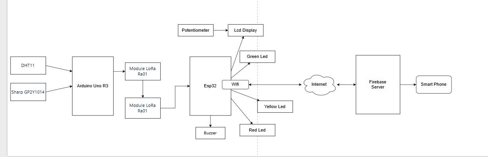
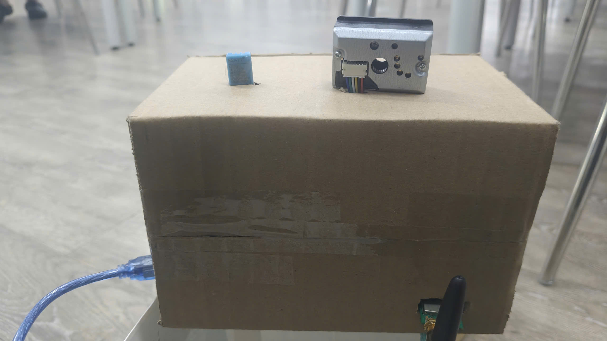
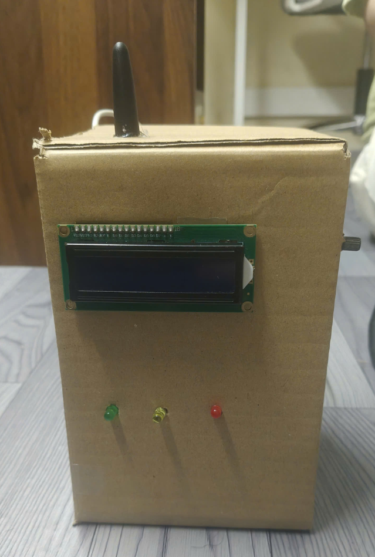
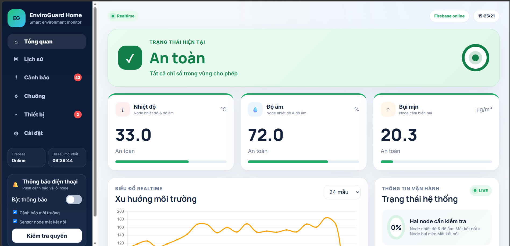
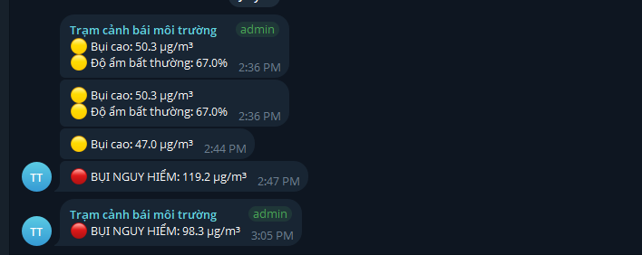

# IoT-Based Environmental Monitoring & Early Hazard Warning System

[](https://docs.arduino.cc/hardware/uno-rev3/)
[](https://www.cdebyte.com/products/E32-433T20D)
[](https://firebase.google.com/)
[](https://core.telegram.org/bots/api)
[](https://www.chartjs.org/)
[](docs/IoT_Project_Report.pdf)

> A robust, long-range, and low-cost environmental telemetry and proactive hazard warning system designed for industrial warehouses, enclosed livestock farms, and smart greenhouses. Featuring **Two-Way LoRa Communication**, **Edge Delta Filtering**, **Non-Volatile Offline Resilient Gateway**, and **Multi-Channel Alerts**.

---

## 📌 Table of Contents
- [Overview & Problem Statement](#overview--problem-statement)
- [System Architecture](#system-architecture)
- [Key Technical Innovations](#key-technical-innovations)
- [Hardware Architecture & Pinout](#hardware-architecture--pinout)
- [Communication Protocol Specification](#communication-protocol-specification)
- [Repository Structure](#repository-structure)
- [Experimental Results](#experimental-results)
- [Getting Started & Deployment](#getting-started--deployment)
- [Project Artifacts & Media](#project-artifacts--media)
- [Authors & Acknowledgments](#authors--acknowledgments)

---

## 📖 Overview & Problem Statement

In specialized environments such as pharmaceutical storage, smart agriculture, and high-density industrial warehouses, maintaining micro-climatic equilibrium (temperature, relative humidity, and fine particulate matter PM2.5) is critical. Conventional commercial telemetry stations are often cost-prohibitive, power-hungry, and vulnerable to single-point Wi-Fi failures.

This project delivers an end-to-end edge-computing IoT solution:
* **Sensor Node (Arduino Uno):** Collects microclimate data, performs hardware-level analog signal filtering, and transmits packets over long-range LoRa frequency (433 MHz).
* **Gateway Node (ESP32):** Ingests RF packets, executes multi-tier safety classification, drives local indicators (16x2 LCD, 3-color LEDs, continuous buzzer with snooze capability), retains thresholds in non-volatile flash memory, and synchronizes real-time metrics with Firebase and Telegram Bot API.
* **Web Dashboard:** An interactive, responsive interface with real-time telemetry streaming and historical analytical trends.

---

## 🏗 System Architecture



```
┌────────────────────────────────────────┐
│              SENSOR NODE               │
│  [DHT11] + [Sharp GP2Y1014 Dust Sensor]│
│                   │                    │
│             [Arduino Uno]              │
│       (Delta Filtering + Sleep)        │
│                   │                    │
│          [LoRa E32-433T20D]            │
└───────────────────┬────────────────────┘
                    │ 433 MHz RF
                    │ (Uplink: Telemetry | Downlink: ACK & Config)
                    ▼
┌────────────────────────────────────────┐
│              GATEWAY NODE              │
│          [LoRa E32-433T20D]            │
│                   │                    │
│                [ESP32]                 │
│    (Edge Classification & Storage)     │
│       ├── Local Flash (NVS Backup)     │
│       ├── 16x2 Parallel LCD            │
│       ├── RGB / 3-Color Status LEDs    │
│       └── Active Buzzer (Snooze Logic) │
└──────┬──────────────────────────┬──────┘
       │ Wi-Fi                    │ Wi-Fi / HTTPS
       ▼                          ▼
┌──────────────────────┐   ┌───────────────────────────┐
│ Firebase Realtime DB │   │     Telegram Bot API      │
│  (/latest, /history) │   │ (Anti-Spam Rate-Limiting) │
└──────────┬───────────┘   └───────────────────────────┘
           │ WebSocket / REST
           ▼
┌──────────────────────┐
│ Responsive Dashboard │
│  (HTML5 + Chart.js)  │
└──────────────────────┘
```

---

## ⚡ Key Technical Innovations

### 1. Two-Way LoRa Communication & Downlink Handshake
Rather than operating as a naive unidirectional broadcaster, the Sensor Node activates a **3-second Listen Window** immediately after every transmission. During this window, the Gateway can issue ACKs and push real-time parameter reconfigurations down to the field node without requiring physical redeployment.

### 2. Multi-Tier Delta Filtering Matrix
To mitigate RF channel contention and conserve battery life, traditional fixed-interval heartbeats are bypassed:
* **Deviation Trigger:** A packet is generated immediately if environmental changes exceed user-defined sensitivity thresholds:
  $$\Delta T \ge 0.5^\circ\text{C}, \quad \Delta H \ge 2.0\%, \quad \Delta D \ge 5.0\,\mu\text{g/m}^3$$
* **State Transition Trigger:** Immediate overdrive transmission upon crossing status boundaries (`SAFE` $\rightarrow$ `WARNING` $\rightarrow$ `DANGER`).
* **Scheduled Trigger:** Fallback synchronizations at pre-configured daily timestamps (`fixedTimes`).

### 3. Sharp GP2Y1014 Optical Dust Signal Conditioning
To overcome baseline drift and high-frequency power supply ripple:
* **20-Cycle Oversampling:** The internal infrared LED is pulsed for exactly $280\,\mu\text{s}$ via digital pin D7, capturing analog ADC values at peak light intensity before a $40\,\mu\text{s}$ stabilization delay.
* **Rate-of-Change Clamping:** If a newly computed concentration deviates by $>50\%$ from the previous reading, adjustment is constrained to $30\%$ of the absolute delta, clamped within $[0.5\times, 2.0\times]$ boundaries.

### 4. Standalone Failsafe (Offline Resilient Gateway)
The ESP32 uses the **Preferences (NVS)** library to persist configuration thresholds, snooze modes, and alert settings in non-volatile flash memory. In the event of a Wi-Fi or Internet outage, the local edge-computing safety loop continues to operate autonomously with zero interruption to LCD status, status LEDs, and physical alarms.

### 5. Multi-Tier Alert Matrix & Anti-Spam Rate Limiter
* `SAFE` (Green LED): All metrics within operating limits.
* `WARNING` (Yellow LED): Metrics deviate from baseline; formatted Telegram alert dispatched (rate-limited to 1 message / 5 minutes).
* `DANGER` (Red LED + Active Buzzer): Critical hazard detected; persistent audible alarm activated; urgent Telegram alert dispatched (rate-limited to 1 message / 2 minutes).
* **Buzzer Snooze:** Configurable countdown timer suppressing audible annoyance while maintenance personnel perform physical on-site intervention.

---

## 🔌 Hardware Architecture & Pinout

### Sensor Node (Arduino Uno)
| Component | Arduino Pin | Description |
| :--- | :--- | :--- |
| **DHT11** | `D2` | Digital 1-Wire Data bus |
| **Sharp GP2Y1014** | `D7` | Infrared LED pulse control pin |
| **Sharp GP2Y1014** | `A0` | Analog optical dust sensor output |
| **LoRa E32-433T20D** | `D11` (RX) | SoftwareSerial RX (Connects to LoRa TX) |
| **LoRa E32-433T20D** | `D10` (TX) | SoftwareSerial TX (Connects to LoRa RX) |
| **LoRa E32-433T20D** | `D3` (M0) | Operating mode control pin M0 |
| **LoRa E32-433T20D** | `D4` (M1) | Operating mode control pin M1 |

### Gateway Node (ESP32 DevKit)
| Component | ESP32 Pin | Description |
| :--- | :--- | :--- |
| **LoRa E32-433T20D** | `GPIO 16` (RX2) | Hardware UART2 RX (Connects to LoRa TX) |
| **LoRa E32-433T20D** | `GPIO 17` (TX2) | Hardware UART2 TX (Connects to LoRa RX) |
| **16x2 Parallel LCD** | `GPIO 19, 21` | LCD Control: RS, EN |
| **16x2 Parallel LCD** | `GPIO 22, 23, 25, 33` | LCD 4-bit Data: D4, D5, D6, D7 |
| **Red LED** | `GPIO 27` | Visual indicator for `DANGER` state |
| **Yellow LED** | `GPIO 13` | Visual indicator for `WARNING` state |
| **Green LED** | `GPIO 18` | Visual indicator for `SAFE` state |
| **Active Buzzer** | `GPIO 26` | Audible acoustic alarm output |

---

## 📡 Communication Protocol Specification

### Uplink Packet (Sensor $\rightarrow$ Gateway)
A comma-delimited string payload terminated with newline `\n`:
```text
<Temperature>,<Humidity>,<DustDensity>,<AlertLevel>
```
*Example:* `29.4,62,38.5,0`

### Downlink Configuration Commands (Gateway $\rightarrow$ Sensor)
Transmitted during the Sensor Node's active 3-second Listen Window:
* `CMD:INTERVAL=<seconds>` : Updates base wake-up reporting interval.
* `CMD:DELTA=<dTemp>,<dHumi>,<dDust>` : Updates deviation thresholds for Delta Filtering.
* `CMD:LIMIT_TEMP=<safe_l>,<safe_h>,<warn_l>,<warn_h>,<dang_l>,<dang_h>` : Updates temperature classification thresholds.
* `CMD:LIMIT_HUMI=...` & `CMD:LIMIT_DUST=...` : Updates humidity and particulate thresholds.
* `CMD:FIXED_TIMES=<hh:mm,hh:mm,...>` : Synchronizes fixed daily reporting timestamps.
* `CMD:TIME=<unix_epoch>` : Synchronizes system time from Gateway NTP clock.

---

## 📂 Repository Structure

```
.
├── .gitignore
├── README.md
├── firmware/
│   ├── sensor_node/
│   │   └── sensor_node.ino          # Arduino Uno firmware (LowPower, Delta Filter, LoRa 2-way)
│   └── gateway_node/
│       └── gateway_node.ino         # ESP32 firmware (LCD, LoRa, Flash NVS, Telegram, Firebase)
├── web_dashboard/
│   ├── index.html                   # Responsive telemetry monitoring dashboard
│   ├── style.css                    # Dark-mode industrial CSS styling
│   └── app.js                       # Real-time Chart.js & sensor analytics logic
└── docs/
    ├── IoT_Project_Report.pdf       # Comprehensive research & development report (LaTeX compiled)
    ├── IoT_Presentation.pptx       # Final project defense presentation deck
    ├── sample_database_export.json  # Exported Firebase Realtime Database schema and test logs
    └── images/                      # Schematic diagrams, prototype photos, and test captures
        ├── system_architecture.jpg
        ├── gateway_flowchart.png
        ├── sensor_node_schematic.png
        ├── sensor_prototype.jpg
        ├── gateway_prototype.png
        ├── web_dashboard.png
        ├── telegram_alerts.png
        └── firebase_realtime_db.png
```

---

## 📊 Experimental Results

### LoRa Transmission Range & Penetration Evaluation
Tested in an urban setting featuring heavy reinforced concrete barriers:

| Distance | Obstacle Profile | Packets Sent | Packets Received | Packet Delivery Ratio (PDR) |
| :--- | :--- | :---: | :---: | :---: |
| **10 m** | Line of sight (Open air) | 120 | 120 | **100.0%** |
| **50 m** | 1 Concrete wall | 120 | 120 | **100.0%** |
| **100 m** | 2 Concrete walls | 120 | 118 | **98.3%** |
| **200 m** | 3 Concrete walls | 120 | 115 | **95.8%** |
| **350 m** | Multiple structural walls | 120 | 109 | **90.8%** |
| **500 m** | Multiple walls + dense foliage | 120 | 100 | **83.3%** |

### Scenario Verification Matrix
| # | Temp (°C) | Humidity (%) | Dust ($\mu\text{g/m}^3$) | Expected State | Evaluated State | Result |
| :-: | :-: | :-: | :-: | :-: | :-: | :-: |
| 1 | 29.0 | 52.0 | 32.0 | `SAFE` | `SAFE` | **PASSED** |
| 2 | 38.0 | 57.0 | 49.0 | `WARNING` | `WARNING` | **PASSED** |
| 3 | 31.0 | 66.0 | 28.0 | `WARNING` | `WARNING` | **PASSED** |
| 4 | 34.0 | 89.0 | 43.0 | `DANGER` | `DANGER` | **PASSED** |
| 5 | 32.0 | 53.0 | 68.0 | `WARNING` | `WARNING` | **PASSED** |
| 6 | 33.0 | 60.0 | 74.0 | `DANGER` | `DANGER` | **PASSED** |
| 7 | 39.0 | 72.0 | 71.0 | `DANGER` | `DANGER` | **PASSED** |
| 8 | 28.0 | 47.0 | 25.0 | `SAFE` | `SAFE` | **PASSED** |

---

## 🚀 Getting Started & Deployment

### Hardware Requirements
1. 1x Arduino Uno R3 (or compatible ATmega328P board).
2. 1x ESP32 DevKit V1 (30-pin or 38-pin).
3. 2x EBYTE LoRa E32-433T20D transceiver modules (with 433MHz antennas).
4. 1x DHT11 temperature and humidity sensor.
5. 1x Sharp GP2Y1014AU0F optical dust sensor (with $150\,\Omega$ resistor & $220\,\mu\text{F}$ capacitor).
6. 1x 16x2 Character LCD (Parallel interface).
7. 3x LEDs (Red, Yellow, Green) with $220\,\Omega$ current-limiting resistors.
8. 1x Active 5V Buzzer.

### Required Software & Libraries
* **Arduino IDE 2.x** or **PlatformIO**
* Arduino Libraries:
  * `DHT sensor library` by Adafruit
  * `Low-Power` by Rocketscream
  * `SoftwareSerial`
  * `Firebase ESP32 Client` by Mobizt
  * `UniversalTelegramBot` by Brian Lough
  * `ArduinoJson` (v6.x)
  * `LiquidCrystal`
  * `Preferences` (built into ESP32 core)

### Flashing Firmware
1. **Sensor Node:**
   * Open `firmware/sensor_node/sensor_node.ino` in Arduino IDE.
   * Select board **Arduino Uno**, select COM port, and click **Upload**.
2. **Gateway Node:**
   * Open `firmware/gateway_node/gateway_node.ino` in Arduino IDE.
   * Update Wi-Fi SSID, Wi-Fi Password, Firebase Credentials, and Telegram Bot Tokens in the configuration section.
   * Select board **ESP32 Dev Module**, select COM port, and click **Upload**.
3. **Web Dashboard:**
   * Open `web_dashboard/index.html` directly in any modern browser.

---

## 📷 Project Artifacts & Media

| Hardware Prototype (Sensor Node) | Hardware Prototype (Gateway Node) |
| :---: | :---: |
|  |  |

| Web Monitoring Dashboard | Telegram Emergency Alerts |
| :---: | :---: |
|  |  |

---

## 👥 Authors & Acknowledgments

* **Group 3 (SE2040) — FPT University**
* **Project Academic Supervisor:** Mr. Nguyen Tri Thong
* **Demonstration Video:** [Watch on YouTube](https://youtu.be/iTY4duVQlrI?si=Rn_Kyp6eaRANaa9H)

---

### 📄 License
This project is released under the [MIT License](https://opensource.org/licenses/MIT). Feel free to adapt and build upon this research.
